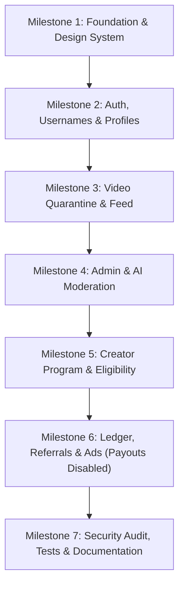

# CreatorLoop (DarkPAKI VIP) — Master Implementation Plan

> **Specification Reference:** Derived from all 10 project specification files in `CreatorLoop_Docs/` (`ANTIGRAVITY_MASTER_PROMPT.md`, `PRODUCT_REQUIREMENTS.md`, `TECHNICAL_ARCHITECTURE.md`, `DATABASE_SCHEMA.md`, `SECURITY_PRIVACY.md`, `AI_MODERATION.md`, `MONETIZATION_WALLET.md`, `ADMIN_OPERATIONS.md`, `ROADMAP_TESTING.md`, `README.md`).

---

## 1. Executive Summary & Vision
CreatorLoop is a professional, mobile-first social video platform designed with an ultra-premium dark aesthetic (near-black background with neon crimson, purple, emerald, and amber accents). The platform integrates creator video publishing, Instagram-inspired social graphs, mandatory admin moderation with AI-assisted risk signals, a transparent creator monetization program, server-controlled wallet ledgers, and fraud-resistant referral engines.

In accordance with core engineering principles:
* **Zero Mock Financials in Production:** Payouts and cash withdrawals remain disabled by default until financial, provider, and compliance gates are approved.
* **Server-Only Authority:** Clients cannot directly write balances, roles, view counts, moderation decisions, or ad rewards.
* **Append-Only Accounting:** All wallet modifications operate through an immutable ledger with reversal records.
* **Mandatory Pre-Publish Moderation:** All uploaded videos enter quarantine as `pending_review` and are never publicly accessible until approved by an authorized reviewer.

---

## 2. Existing Repository Assessment

### Existing Assets & Architecture:
1. **Core Server (`src/server.js`):** Express 5.x on Node.js 22+ with Helmet security headers, CORS protection, JSON body parsing, and rate limiting (`express-rate-limit`).
2. **Database Engine (`src/db/database.js`):** SQLite with WAL mode (`data/darkpaki.db`), handling `users`, `videos`, `demands`, `demand_votes`, `comments`, `comment_likes`, `withdrawals`, `settings`, `security_logs`, `ai_images`, `monetization_applications`, and `email_otps`.
3. **Authentication Layer (`src/controllers/authController.js`):**
   * Real Google OAuth ID token verification.
   * Email + bcrypt password login with 6-digit OTP verification.
   * 1-Device = 1-Account hardware fingerprint binding.
   * Cloudflare Turnstile bot verification.
4. **Admin Dashboard (`public/admin.html` & `src/controllers/adminController.js`):**
   * Master PIN verification (`7860`).
   * Video approval/rejection queue.
   * Monetization application reviews.
   * Platform settings configuration (CDN endpoints, Telegram links, ad codes, Turnstile keys, Google OAuth client ID).
5. **E2E Testing Suite (`test-e2e.js`):** 25 automated end-to-end integration tests currently passing (100% pass rate).
6. **Secondary Micro-Package (`rewards/`):** Next.js 15 + PostgreSQL + Redis rewards structure designed for secondary scaling.

### Gaps & Upgrades Required for Full CreatorLoop Compliance:
1. **Username Uniqueness & Reservation:** Formalize `usernames` lookup table to guarantee zero race-condition username squatting.
2. **Social Graph Expansion:** Expand `follows` relationships with dedicated follower/following counters and an Instagram-inspired profile tab view (Videos, Saved, Demands, Monetization).
3. **Quarantine Media Pipeline:** Implement explicit lifecycle transitions: `uploading -> processing -> pending_review -> approved | rejected | needs_changes -> published`.
4. **AI Moderation Adapter:** Implement a provider-agnostic AI moderation engine with automated safety checks (NSFW/adult, violence, hate/harassment, copyright/similarity risk signals) and a strictly labelled Mock Mode.
5. **Creator Program Eligibility Engine:** Formalize the 100 followers + 1,000 qualified views eligibility check, application submission, and estimated vs. finalized earnings dashboard.
6. **Immutable Financial Ledger:** Implement `wallet_ledger` (integer minor units, append-only, reversal transactions) and enforce that withdrawals remain strictly disabled.
7. **Role-Based Access Control (RBAC):** Distinct roles for `visitor`, `user`, `creator`, `monetized_creator`, `moderator`, `finance`, and `admin`.

---

## 3. Milestone Roadmap

### Milestone 1 — Project Foundation & UI Design System
* Establish CSS design tokens and variables: near-black `#050508`, card surface `#0c0c12`, borders, neon accents (`#f43f5e` crimson, `#a855f7` purple, `#10b981` emerald, `#f59e0b` amber).
* Refactor app shell navigation:
  * Top navigation: Logo branding, search, notifications indicator, profile/wallet pill.
  * Mobile bottom bar: Home, Explore, Upload (+), Community Demands, Profile/Dashboard.
* Add comprehensive environment configuration validation (`.env.example`).
* Document architecture conventions and setup in `README.md`.

### Milestone 2 — Authentication, Username Reservation & Profiles
* Google OAuth + Email/Password + 6-digit OTP verification with device authorization.
* Dedicated `usernames` reservation table to prevent username squatting.
* Instagram-inspired creator profile:
  * Avatar, display name, verified badge, bio, join date.
  * Follower & Following stats.
  * Tabbed interface: Videos, Community Demands, Saved Vault, Creator Dashboard.
* Follow/Unfollow API with duplicate prevention and atomic count updates.

### Milestone 3 — Video Upload Workflow & Quarantine Feed
* Secure upload endpoint with file type, size, and duration validation.
* Video states: `uploading` -> `processing` -> `pending_review` -> `published`.
* Strict feed gating: Public feed endpoints query **only** `status = 'approved'` or `status = 'published'`.
* Engagement features: Likes, threaded comments, shares, saves, and report actions with rate limits.
* Qualified view tracking with bot filtering.

### Milestone 4 — Admin Console & AI Moderation Adapter
* Protected admin routes with role validation (`moderator`, `finance`, `admin`).
* Pending video review queue with video player preview, metadata inspector, and reason codes.
* AI Moderation Adapter:
  * Pluggable interface for computer vision & text moderation.
  * Labeled Mock Mode with deterministic rule-based checks.
  * Outputs: Safety category scores, similarity risk level, confidence, and reviewer recommendations.
* User reports and appeals processing queue.
* Append-only `audit_logs` tracking privileged reviewer actions.

### Milestone 5 — Creator Monetization Program
* Application eligibility verification:
  * Minimum 100 followers.
  * Minimum 1,000 qualified video views.
  * Verified account standing and age confirmation.
* Creator application submission and admin review interface.
* Creator Dashboard:
  * Separation of estimated, pending, held, and finalized earnings.
  * Metric cards: Total qualified views, engagement rate, monetization status pill.

### Milestone 6 — Financial Ledger, Referrals & Rewarded Ads
* `wallet_ledger` table:
  * Immutable, append-only schema (integer minor currency units).
  * Entry types: `creator_revenue`, `referral_reward`, `ad_reward`, `reversal`, `adjustment`.
* Rewarded Ad integration interface with signed callback verification.
* Referral system: Unique codes, pending hold period, qualification verification, fraud prevention.
* **Compliance Gate:** Real-money withdrawals and crypto payouts remain strictly locked (`disabled`) with clear informative UI notifications.

### Milestone 7 — Security Auditing, E2E Testing & Release Gates
* Comprehensive security test suite:
  * Authorization bypass checks.
  * IDOR tests on user resources.
  * Double-spend / race condition prevention on ledger entries.
  * Rate-limit verification on sensitive endpoints.
* Production documentation deliverables:
  * `README.md`
  * `KNOWN_LIMITATIONS.md`
  * `DEPLOYMENT.md`
  * `SECURITY_CHECKLIST.md`

---

## 4. Dependencies, Risks & Missing Configurations

| Item | Status | Risk / Mitigation |
| :--- | :--- | :--- |
| **Google OAuth Client ID** | Configured in DB & `.env` | Must ensure origins match `http://localhost:5000` and live domain. |
| **Cloudflare Turnstile** | Functional with fallback | Production site/secret keys can be updated in Admin Settings anytime. |
| **External Transcoding** | Local FFmpeg / Canvas proxy | Fallback to browser-side metadata extraction and proxy previews. |
| **Real Money Payouts** | Intentionally Disabled | Feature flag locked; no user balances can be cashed out without legal review. |
| **AI Moderation Provider** | Pluggable Adapter | Runs in deterministic local mock mode with full UI signals when no cloud API key is present. |

---

## 5. Execution Strategy
Development will proceed sequentially from **Milestone 1** through **Milestone 7**. Each milestone will be validated with automated tests and a progress report detailing modified files, working features, and verification results before proceeding to the next.
